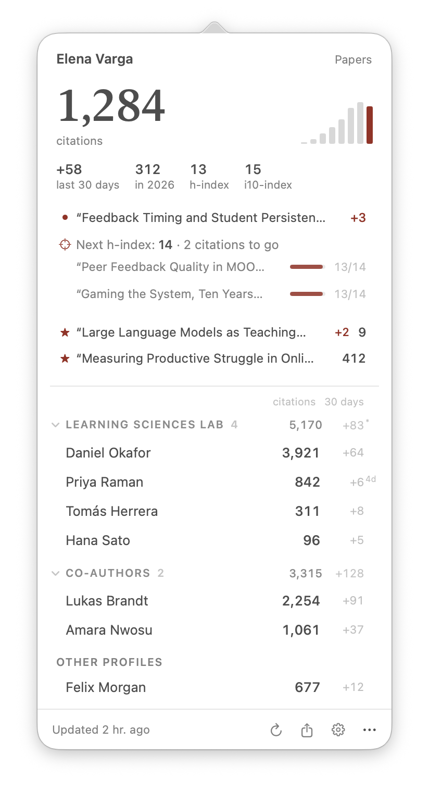
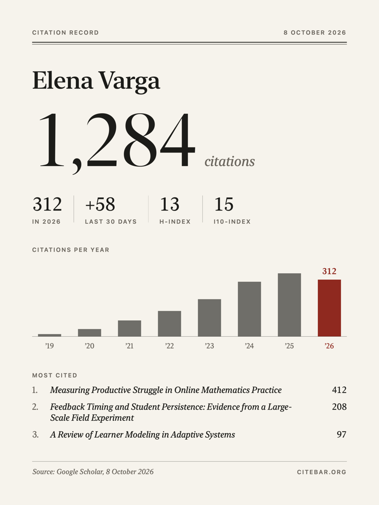
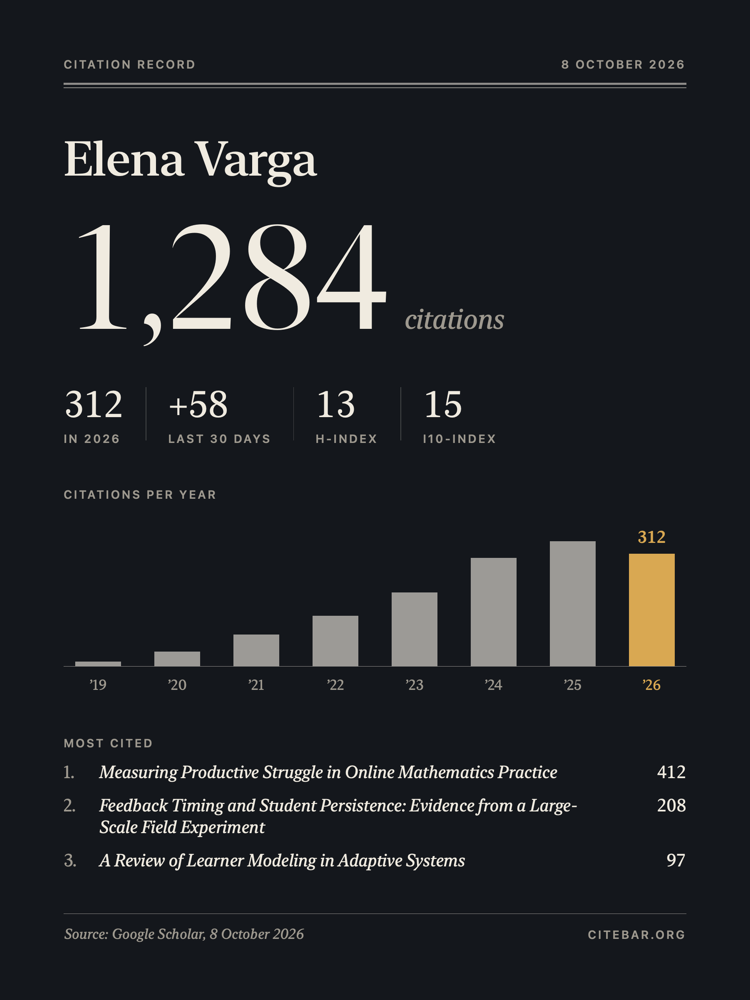
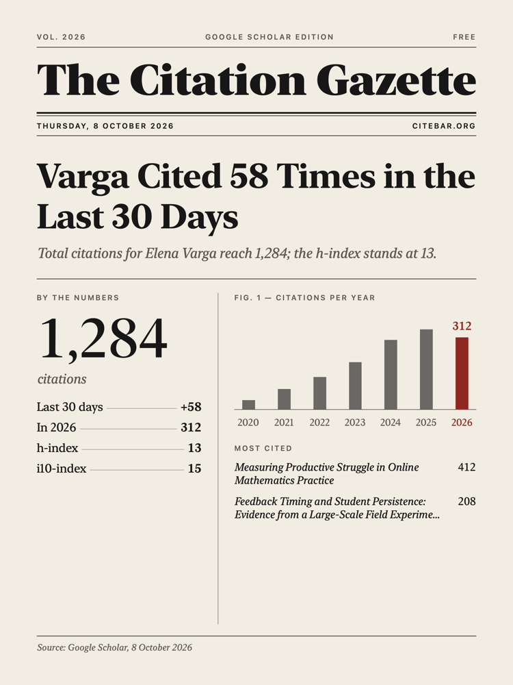
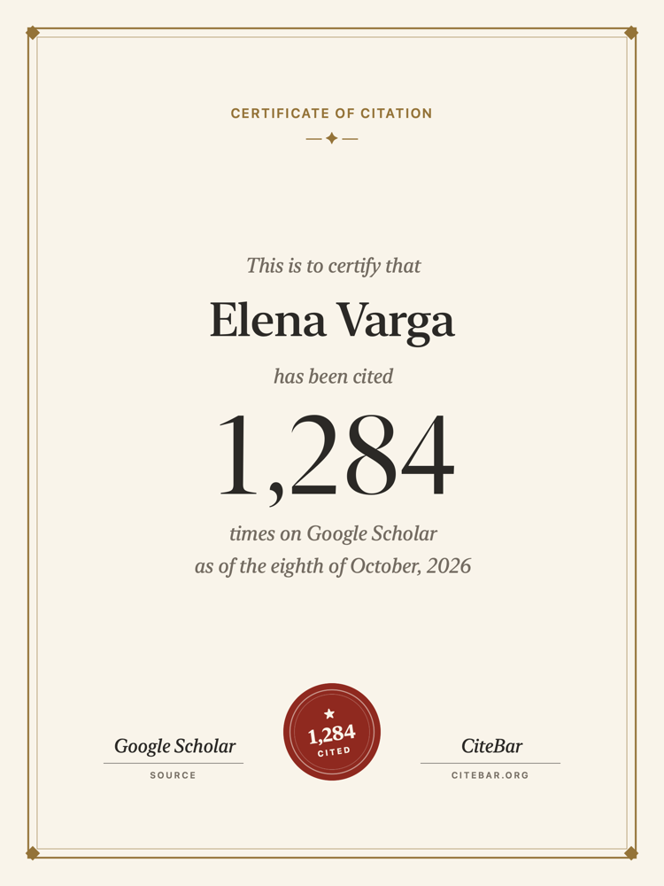

<div align="center">

[English](../README.md) · [简体中文](README.zh-CN.md) · [繁體中文](README.zh-TW.md) · [日本語](README.ja.md) · [한국어](README.ko.md) · [Español](README.es.md) · [Português](README.pt-BR.md) · **Deutsch** · [Français](README.fr.md) · [Русский](README.ru.md)


# CiteBar

**Schluss mit dem ständigen Neuladen von Google Scholar.**<br>
Für alle, die ihre Zitationen ein bisschen zu oft checken.

[Download](https://github.com/hichipli/CiteBar/releases/latest) · [Website](https://www.citebar.org/) · `brew install --cask hichipli/tap/citebar`

  [](https://github.com/hichipli/CiteBar/releases)
  [](https://www.apple.com/macos/)
  [](https://swift.org)
  [](../LICENSE)
  [](https://github.com/hichipli/CiteBar/releases)


</div>

---

## Warum CiteBar?

Weil es keine produktive Forschung ist, alle 20 Minuten dein Google-Scholar-Profil neu zu laden. CiteBar macht aus dem Browser-Tab, den du einfach nicht zulassen kannst, einen stillen Begleiter in der Menüleiste: Es schaut einmal am Tag nach, sagt dir, welches Paper gerade zitiert wurde, und lässt dich den Rest der Zeit in Ruhe.

Ideal für Forschende, die den Impact ihrer Paper im Blick behalten wollen, für Promovierende, die ihre ersten Zitationen feiern, für Lab-Leitungen, die eine ganze Arbeitsgruppe verfolgen, und für alle, die sich schon mal gefragt haben: „Hat sich mein h-index gerade bewegt?“

## Schnellstart

**Du willst CiteBar einfach nur benutzen?** Überspring den technischen Teil und leg in etwa einer Minute los.

1. **Lade die neueste Version herunter**
   - Öffne [GitHub Releases](https://github.com/hichipli/CiteBar/releases/latest).
   - Lade die Datei `CiteBar-x.x.x-universal-[date].dmg` herunter.
   - Das Universal-DMG läuft sowohl auf Macs mit Apple Silicon als auch auf Intel-Macs.
   - Lieber Homebrew? `brew install --cask hichipli/tap/citebar` erledigt Schritt 1 und 2 für dich.

2. **Installiere CiteBar**
   - Öffne das DMG.
   - Zieh `CiteBar.app` in den Ordner `Applications` (Programme).
   - Starte CiteBar aus `Applications`.

3. **Füge dein Profil hinzu**
   - Beim ersten Start öffnet CiteBar das Fenster Add Profiles. Füg dort den Link zu deinem Google-Scholar-Profil ein.
   - Du willst ein Lab oder deine Co-Autor:innen verfolgen? Füg einfach alle Links auf einmal ein, einen pro Zeile, und pack sie in eine Gruppe.
   - Standardmäßig wird täglich aktualisiert. Google Scholar selbst aktualisiert sich nur alle ein bis zwei Tage, damit bleibt CiteBar also auf dem neuesten Stand.

Du kannst den vollständigen Profil-Link einfügen oder nur die ID, also den Wert von `user` in der URL:

```text
https://scholar.google.com/citations?user=YOUR_ID_HERE
```

Aktuelle Versionen sind mit einer Apple Developer ID signiert und von Apple notarisiert. Bei Apps aus dem Internet kann macOS beim ersten Start trotzdem die übliche Sicherheitsabfrage anzeigen.

Falls du von `1.3.x` oder `1.4.1` aktualisierst, installier das neueste DMG einmal von Hand. Danach funktionieren die automatischen Updates in der App ganz normal.

Probleme bei der Installation? Schau in die [Installationsanleitung](../DISTRIBUTION.md) (auf Englisch).

## Funktionen, auf die es ankommt



**Die Zahl, mit Kontext**
- Deine Zitationszahl sitzt in der Menüleiste; ein Klick öffnet das Panel
- Zitationen pro Jahr, Zitationen in diesem Jahr, Zuwachs der letzten 30 Tage, h-index und i10-index
- Sieh, welches Paper gerade zitiert wurde, und klick dich durch, um zu sehen, wer es zitiert hat
- Wenn dein nächster h-index in Reichweite ist, siehst du genau, welche Paper noch Zitationen brauchen und wie viele jeweils
- Behalte bestimmte Paper im Auge: Markier sie im Papers window mit einem Stern, dann bleiben sie im Panel und ihre neuesten Zitationen stehen in Mitteilungen ganz oben
- Spaltenbeschriftungen und Hover-Hinweise erklären jede Zahl

**Gruppen für Labs und Kooperationen**
- Fass Profile zu einem Lab, deinen Co-Autor:innen oder einem Jahrgang zusammen, mit gemeinsamen Zitationen und dem Zuwachs der letzten 30 Tage
- Füg eine ganze Liste von Scholar-Links auf einmal ein
- Kopier die Links einer Gruppe und teil sie mit deinem Lab, damit alle sie in ihr eigenes CiteBar einfügen können

**Mitteilungen, die sich lohnen**
- Mitteilungen nennen die Paper, die neue Zitationen bekommen haben
- Meilensteine wie 100 oder 1.000 Zitationen oder ein höherer h-index bekommen eine eigene Mitteilung
- Kein „Nichts hat sich geändert“-Rauschen

**Ein Zitationsrekord, den man gern teilt**
- Vier Kartenstile: Record, Night, Gazette (eine Titelseite mit einer Schlagzeile, die aus deinen Zahlen geschrieben wird) und Certificate
- Du bestimmst, was zu sehen ist: Zitationen pro Jahr, h-index, die meistzitierten Paper oder ein einzelnes Paper, Zuwachs über 7 bis 365 Tage und eine Notiz
- Mit einem Klick teilen (AirDrop, Nachrichten, Mail), kopieren oder sichern, direkt aus dem Panel oder über das ⋯-Menü eines beliebigen Profils in den Einstellungen

   

**Eine Zeitmaschine für deinen Rekord**
- Zieh auf einer Zeitleiste zu einem beliebigen Tag und erstell die Karte für genau diesen Tag
- Zitations-Meilensteine und Anstiege des h-index sind markiert, so kannst du auch einen Moment teilen, den du verpasst hast
- Funktioniert ab dem ersten Tag: Meilensteine aus der Zeit vor der Installation von CiteBar werden anhand der Jahreszahlen von Google Scholar datiert und mit ~ gekennzeichnet, und jeder Tag danach wird exakt aufgezeichnet

**Rücksichtsvoll und zuverlässig**
- Eine Anfrage pro Profil, jeweils zwei Sekunden Abstand
- Bei Netzwerkaussetzern wird automatisch neu versucht; bei Rate Limits von Google Scholar wird schrittweise gebremst (von 15 Minuten bis zu 4 Stunden) und danach von selbst weitergemacht
- Refresh Now funktioniert jederzeit
- Automatische Updates über Sparkle

**Datenschutz von Anfang an**
- Alle Daten bleiben auf deinem Mac
- Keine Telemetrie
- Keine CiteBar-Server, keine Accounts

**Deine Daten, frei mitnehmbar**
- Settings › Data zeigt dir, wo die Daten liegen (`~/Library/Application Support/CiteBar/`) und wie viel Platz jeder Teil belegt: Zitationsverlauf, Paper-Listen und Paper-Verlauf
- Behalte den Zitationsverlauf für immer (Standard) oder für 5, 2 oder 1 Jahr
- Der optionale Paper-Verlauf speichert die Zahl jedes Papers, sobald sie sich ändert, so zeigt die Zeitmaschine auch für vergangene Tage die Paper an
- Exportier alles (Profile, Gruppen, Einstellungen, kompletter Verlauf) in eine Datei und importier sie auf einem neuen Mac; der Import fügt nur hinzu und löscht nie etwas
- Optionales automatisches Backup nach jeder Aktualisierung in iCloud Drive oder einen beliebigen Ordner, etwa Google Drive oder Dropbox

**Echtes macOS-Gefühl**
- Schlank in der Menüleiste, mit hellem und dunklem Erscheinungsbild
- Native Einstellungen mit den Tabs Profiles, General, Data und About
- Start bei der Anmeldung
- Unterstützt Apple Silicon und Intel

**Leicht genug, um einfach weiterzulaufen**
- Im Leerlauf praktisch keine CPU-Last
- Minimaler Netzwerkverkehr in Intervallen, die du selbst festlegst
- Mehr Details zur Umsetzung in den [technischen Hinweisen](../TECHNICAL.md) (auf Englisch)

## Datenschutz

CiteBar liest ausschließlich öffentlich zugängliche Google-Scholar-Profilseiten. Deine Einstellungen und dein Zitationsverlauf bleiben auf deinem Mac, gespeichert unter `~/Library/Application Support/CiteBar/`.

Die App arbeitet mit zurückhaltenden Aktualisierungsintervallen, Pausen zwischen den Anfragen und einem Backoff nach Fehlern, damit sie Zitationszahlen verantwortungsvoll abfragt.

## Hilfe und Projektdokumentation

- Installation oder Sicherheitsdialoge von macOS: [Installationsanleitung](../DISTRIBUTION.md)
- Aus dem Quellcode bauen: [Setup-Anleitung](../SETUP.md)
- Bugs und Feature-Wünsche: [GitHub Issues](https://github.com/hichipli/CiteBar/issues)
- Änderungen am Projekt: [Changelog](../CHANGELOG.md)

Die Dokumentation ist auf Englisch, Issues kannst du aber gern auf Deutsch schreiben.

Du hast eine Idee, einen noch unausgegorenen Feature-Wunsch oder einen Workflow, den CiteBar noch nicht so richtig unterstützt? Eröffne ein Issue. Du musst weder mit einem ausgefeilten Vorschlag noch mit einem Pull Request ankommen; praktisches Feedback aus echten Forschungsabläufen hilft schon für sich allein.

## Entwickler:innen und Mitwirkende

Du willst aus dem Quellcode bauen, Code beitragen oder verstehen, wie CiteBar unter der Haube funktioniert?

```bash
git clone https://github.com/hichipli/CiteBar.git
cd CiteBar
make build
make run
```

Nützliche Projektdokumente (auf Englisch):

- [Leitfaden für Beiträge](../CONTRIBUTING.md)
- [Technische Hinweise](../TECHNICAL.md)
- [Release-Anleitung](../RELEASING.md)
- [Versionsverwaltung](../VERSION_MANAGEMENT.md)

## Lizenz

CiteBar steht unter der [MIT-Lizenz](../LICENSE).

## Community

Danke an alle, die CiteBar besser machen.

<div>
  <a href="https://github.com/CassWang1"></a>
  <a href="https://github.com/lukestein"></a>
  <a href="https://github.com/DABH"></a>
  <a href="https://github.com/yizirui"></a>
</div>

---

<div align="center">

**Mit Sorgfalt für die akademische Community gebaut**

[Neueste Version herunterladen](https://github.com/hichipli/CiteBar/releases/latest) | [Problem melden](https://github.com/hichipli/CiteBar/issues) | [Mitmachen](../CONTRIBUTING.md)

</div>
